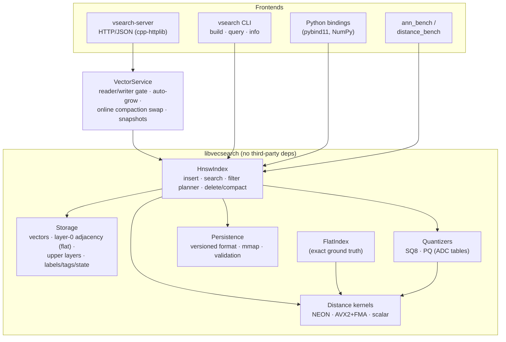
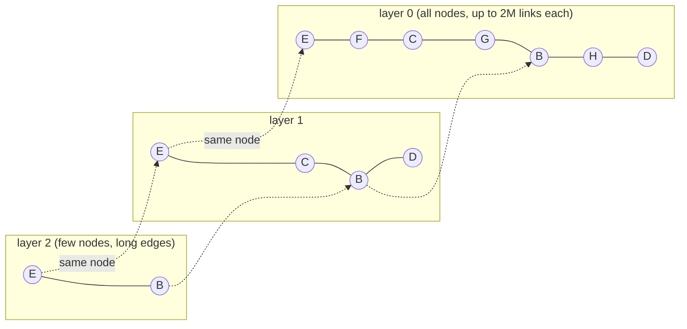
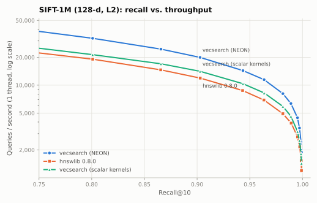
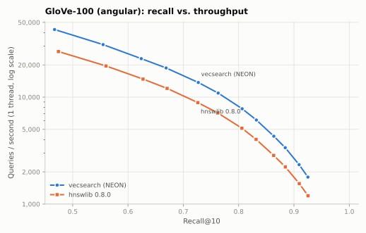
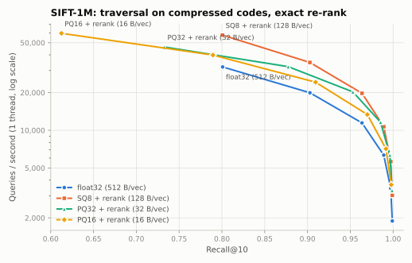
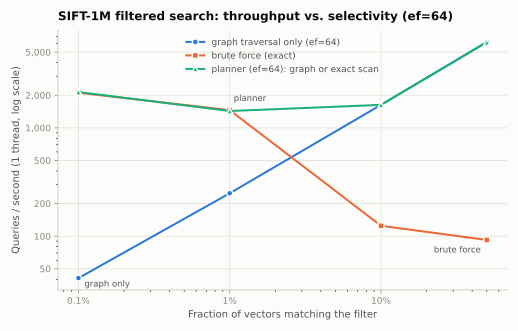

# vecsearch

A vector search engine in C++20, built around an HNSW index written from scratch. The goal
is the core of a FAISS/hnswlib-style engine done carefully: hand-written NEON and AVX2
distance kernels, a multithreaded build where searches never take a lock, tombstone deletes
with compaction, SQ8 and PQ compression with exact re-ranking, filtered search with a
cost-based planner, a versioned on-disk format that can be memory-mapped, and an HTTP/JSON
server. It is tested under AddressSanitizer, UBSan and ThreadSanitizer, and benchmarked on
SIFT-1M and GloVe-100 against hnswlib on the same machine. All benchmark numbers below were
measured; the methodology section says how.

**Headline (SIFT-1M, M=16, efConstruction=200, Apple M4, measured against hnswlib 0.8.0 on
the same machine):**

| | vecsearch | hnswlib 0.8.0 |
|---|---:|---:|
| QPS at recall@10 ≥ 0.90 (1 thread) | **19,930** | 11,917 |
| QPS at recall@10 ≥ 0.95 (1 thread) | **11,456** | 6,913 |
| QPS at recall@10 ≥ 0.99 (1 thread) | **4,450** | 2,768 |
| QPS at ef=64 (recall 0.963–0.964), 10 threads | **60,497** | 37,923 |
| Build, 1M vectors, 10 threads | **40.1 s** | 69.3 s |
| QPS at recall 0.964 with SQ8 codes + exact re-rank | **19,744** | — |
| Load 636 MiB index (mmap) | **49 ms** | — |

Both libraries reach the same recall at each `ef`. The measured ~1.65× query-speed gap
breaks down into about 1.4× from the hand-written NEON kernels (hnswlib has no NEON path,
so it runs scalar loops here) and about 1.2× from memory layout and prefetching, which shows
when vecsearch also runs scalar kernels. See [Benchmarks](#benchmarks) for the methodology.

## Features

- **HNSW from the paper.** Multi-layer graph, exponential level sampling, greedy descent on
  the upper layers, beam search with `ef` on layer 0, and the neighbour-selection heuristic
  (Algorithm 4, optional `keepPrunedConnections`). `M`, `efConstruction` and `efSearch` are
  configurable. A brute-force `FlatIndex` provides ground truth.
- **Metrics:** squared L2, inner product, and cosine (vectors are normalised on insert).
- **SIMD kernels:** ARM NEON (4 accumulators × 16 floats) and AVX2+FMA paths, picked at
  compile time, plus a scalar reference. Tests check every kernel against the scalar version
  for every dimension from 1 to 300. The scalar path can also be selected at runtime, which
  is how the SIMD speed-up is measured.
- **Concurrency:** parallel build with 4-byte per-node spin locks. Searches never block:
  adjacency lists are published with release stores and read with acquire loads. Inserts,
  upserts, deletes and searches can all run at the same time; the tests run under TSan.
- **Deletes and upserts:** a delete sets a tombstone, so the node keeps routing traffic but
  is never returned. `compact()` rebuilds the index from the live vectors while searches
  continue.
- **Quantization:** SQ8 (per-dimension affine int8, 4× smaller) and PQ (k-means codebooks,
  16 to 32 bytes per vector), both with asymmetric distances. Traversal runs on the codes
  and the final candidates are re-ranked with the float vectors.
- **Filtered search:** every vector carries a 64-bit tag mask. Filters
  (`any_of`/`all_of`/`none_of`) are checked during traversal, and arbitrary label predicates
  are also supported. A **planner** uses per-tag live counters to estimate selectivity and
  switches to an exact scan when that is predicted to be cheaper than the graph.
- **Persistence:** a versioned, checksummed binary format with 64-byte-aligned sections.
  Saves are atomic (temp file plus rename). `LoadMode::Mmap` maps the vectors, graph and
  codes without copying them. Every adjacency list is validated on load, so a corrupt file
  is rejected instead of being read out of bounds.
- **Serving:** an HTTP/JSON API (cpp-httplib) for upsert, get, delete, search, stats,
  compaction and snapshots, with automatic capacity growth. There is also a CLI
  (`vsearch build|query|info`) and optional **Python bindings** (pybind11, NumPy in and out).
- **Tooling:** GoogleTest suite (48 tests), ASan+UBSan and TSan presets, Google Benchmark
  kernel microbenchmarks, an end-to-end ANN benchmark driver, an hnswlib baseline script,
  and plotting.

## Architecture



The core library depends only on the C++ standard library and POSIX (`mmap`). GoogleTest,
Google Benchmark, cpp-httplib, nlohmann/json and pybind11 come in through CMake
`FetchContent` and are used only by tests, benchmarks, the server and the bindings.

```
include/vecsearch/   public API: hnsw_index.hpp, flat_index.hpp, distance.hpp, quantization.hpp, ...
src/                 index, persistence, kernels (scalar/NEON/AVX2), quantizers, mmap, server/
apps/                vsearch (CLI), vsearch-server
bench/               ann_bench (end-to-end), distance_bench (Google Benchmark)
tests/               GoogleTest suite
python/              pybind11 module
scripts/             dataset preparation, hnswlib baseline, plotting, run_benchmarks.sh
```

## How HNSW works

HNSW keeps a hierarchy of proximity graphs over the same points. Every point is on layer 0.
A point reaches layer `l` with probability `M^-l` (its level is
`floor(-ln(U) * 1/ln M)`), so each layer up has about `1/M` as many nodes. The top layers
are sparse and their edges are long, which makes them a coarse map of the data. Layer 0 is
dense, has the fine-grained edges, and holds up to `2M` links per node.



**Search** (Algorithm 2 and 5 in the paper) starts at the global entry point on the top
layer. On each upper layer it walks greedily, always moving to the neighbour closest to the
query, until no neighbour is closer. It then drops one layer and repeats from that node. On
layer 0 it runs a **beam search**: a min-heap of candidates to expand and a max-heap of the
best `ef` results found so far. It stops when the closest unexpanded candidate is farther
away than the worst of the `ef` results. A larger `ef` gives higher recall and lower
throughput, and that trade-off is what the curves below show.

**Insert** (Algorithm 1) samples the node's level and descends greedily to that level. On
each layer from there down to 0 it runs a beam search with `efConstruction` and picks `M`
neighbours using the **heuristic**: candidates are taken in order of distance, and one is
kept only if it is closer to the new node than to every neighbour already kept. This favours
edges that point in different directions over edges into the same cluster, which keeps
clustered data navigable. Each kept neighbour gets a reverse edge. If that overflows the
neighbour's degree limit, its list is re-pruned with the same heuristic.

## Design decisions and trade-offs

**Memory layout.** Layer-0 adjacency lists are fixed-size `[count, id0 … id(2M-1)]` blocks
in one contiguous array indexed by node id, and vectors live in a separate 64-byte-aligned
contiguous array. Over 90% of search time is spent on layer 0, so there is no pointer
chasing there. Only the roughly `1/M` of nodes with upper layers get a separate small
allocation. These arrays use the same byte layout in memory and on disk, which is what
makes zero-copy `mmap` loading possible.

**Lock-free readers, fine-grained writers.**
- *Write-before-publish.* Node ids are claimed with a CAS and never reused. A node's vector,
  label, tags and level are written before anything links to it.
- *Readers.* Links are written with release stores and read with acquire loads, so a reader
  that sees a node id also sees everything written before it was published. Searches
  therefore take no locks. On AArch64 and x86 an acquire load costs about the same as a
  plain load.
- *Writers.* A writer locks a node's 4-byte spin lock only while it rewrites that node's
  list, and never holds two node locks at once, so lock ordering cannot deadlock. A
  `std::mutex` per node would cost 64 bytes on Darwin, 64 MB per million vectors.
- *One race needs care.* A concurrent inserter can link itself into a new node's list before
  that node has written its own list for the layer. The code merges these links instead of
  overwriting them. TSan runs the concurrency tests: parallel build, searches during
  inserts, deletes during searches, concurrent upserts of the same labels, and compaction
  during searches.

**Deterministic levels.** A node's level is a hash of `(seed, label)`, not the output of a
shared RNG. The layer structure therefore does not depend on thread scheduling, there is no
contended RNG, and a single-threaded build is bit-for-bit reproducible (a test checks this).

**Deletes are tombstones; upsert = tombstone + insert.** Unlinking a node from HNSW in
place means repairing its neighbours' lists, which is expensive and error-prone. Tombstoned
nodes keep routing traffic but are never returned. When results contain tombstones,
filtered nodes or label predicates, the beam keeps expanding until it has `ef` accepted
results. `compact()` rebuilds from the live set, and the server swaps the new index in
atomically. Searches keep running throughout; writes wait.

**Prefetch-batched expansion.** When a node is expanded, all its unvisited neighbours are
collected first and their vectors prefetched together, so up to `2M` cache misses are in
flight at once instead of one after another. Visited sets use 16-bit epoch stamps, so a new
query clears the set with `++epoch` instead of an O(N) memset.

**Asymmetric quantization with re-ranking.** The query stays in float32. SQ8 rescales the
query once so that each code costs one fused widen-subtract-FMA NEON pass. PQ builds an
`m × 256` lookup table per query, so each code costs `m` table lookups. The traversal works
on the small codes, and the `ef` best candidates are then re-scored against the float
vectors. Under `LoadMode::Mmap` those float vectors are only touched for re-ranking.

**A planner for filtered search.** Filtering during traversal makes the beam expand more
nodes before it has `ef` matches. On SIFT-1M the measured distance evaluations grow as
roughly `D(ef)·s^-0.75`, where `D(ef) ≈ 67·ef^0.73` is the unfiltered cost and `s` the
selectivity, so at 1% selectivity the walk does 30× the work. The index keeps live counts
per tag bit and estimates each filter's selectivity. It then compares
`2.5·D(ef)·s^-0.75` (a graph-side distance costs about 2.5 sequential ones, from measured
timings) against an exact scan's `s·N + N/64` (one distance per match plus a tag check per
node), and runs whichever is cheaper. Exact scans skip nodes that are not yet fully
initialised, which a per-node "ready" bit tracks. The constants come from the SIFT
measurements below; another dataset or `M` would shift them somewhat.

**Compile-time SIMD dispatch.** NEON is always present on AArch64, and AVX2 is chosen when
the compiler targets it (`-march=native`, enabled by `VS_NATIVE`). That keeps the hot
distance call a single indirect call with no per-call CPU detection. The trade-off is that
a portable x86 binary needs `VS_NATIVE=OFF` and gets the scalar path. Runtime CPUID dispatch
is listed under future work.

**API hygiene.** RAII everywhere: aligned buffers own their memory, and mappings and file
descriptors are wrapped. There is no raw `new`/`delete`. `[[nodiscard]]` is used on queries
and factories, concepts on `parallel_for` and the byte streams, and a non-owning
`FunctionRef` handles label predicates (one indirect call, no allocation). The code builds
warning-free under
`-Wall -Wextra -Wpedantic -Wshadow -Wconversion -Wsign-conversion -Wold-style-cast -Werror`
on Apple Clang 21 and GCC 16.

## On-disk format (version 1)

All integers are little-endian (the loader rejects big-endian files through an endianness
tag). The layout is:

| Field | Type | Notes |
|---|---|---|
| magic | `char[8]` | `"VSHNSW\0\0"` |
| version | `u32` | currently `1`; newer versions are rejected with a clear error |
| endian tag | `u32` | `0x01020304` |
| metric, quantizer | `u32, u32` | `0=L2 1=IP 2=cosine`; `0=none 1=SQ8 2=PQ` |
| dim, M, efConstruction, seed | `u64 ×4` | layer-0 degree is `2M` |
| node count, entry point, tombstones | `u64 ×3` | entry point packs `(level << 32) \| id` |
| flags, section count | `u32, u32` | bit 0 = keepPruned |
| section table | `{u32 kind, u32 reserved, u64 offset, u64 size}[]` | |
| header checksum | `u64` | FNV-1a over all header bytes above |

Each section starts on a 64-byte boundary:

| Section | Contents |
|---|---|
| `VECTORS` | `n × dim` float32 (normalised for cosine) |
| `LEVEL0` | `n × (1 + 2M)` u32: `[count, ids…]` per node |
| `LEVELS` | `n` u8 |
| `UPPER` | concatenated `levels[i] × (1 + M)` u32 blocks; offsets are recomputed from `LEVELS` |
| `LABELS`, `TAGS` | `n` u64 each |
| `DELETED` | `n` u8, bit 0 = tombstone (other bits reserved) |
| `QUANTIZER`, `CODES` | serialized SQ8/PQ parameters; `n × code_size` u8 (present only if trained) |

Loading checks the magic, version, endianness and header checksum, the bounds, alignment and
exact size of every section, every adjacency entry (degree ≤ limit, id < n, the target
exists on that layer), the entry point, and that live labels are unique. The data payload
itself has no checksum; see limitations.

## Building

Requirements: CMake ≥ 3.25 and a C++20 compiler (Apple Clang 15+, Clang 16+, or GCC 12+).
Dependencies are downloaded at configure time.

```bash
cmake --preset release                  # -O3, -mcpu/-march=native
cmake --build --preset release -j
ctest --preset release                  # 48 tests

cmake --preset asan  && cmake --build --preset asan  -j && ctest --preset asan    # ASan + UBSan
cmake --preset tsan  && cmake --build --preset tsan  -j && ctest --preset tsan    # ThreadSanitizer

# Optional Python module
cmake -S . -B build/py -DVS_BUILD_PYTHON=ON -DPython_EXECUTABLE=$(which python3)
cmake --build build/py -j && PYTHONPATH=build/py/python python3 -c "import vecsearch"
```

## Usage

### C++

```cpp
#include "vecsearch/hnsw_index.hpp"

vs::HnswIndex index({.dim = 128, .metric = vs::Metric::L2, .M = 16,
                     .ef_construction = 200, .capacity = 1'000'000});
index.add_batch(vectors, labels, /*threads=*/0);             // parallel build
auto hits = index.search(query, {.k = 10, .ef = 64});        // [{label, distance}, ...]

auto filtered = index.search(query, {.k = 10, .ef = 64, .filter = {.any_of = 0b100}});
index.remove(42);                                            // tombstone
index.train_quantizer({.type = vs::QuantizerType::SQ8});
auto fast = index.search(query, {.k = 10, .ef = 64, .use_quantized = true});
index.save("index.vsi");
auto mapped = vs::HnswIndex::load("index.vsi", vs::LoadMode::Mmap);
```

### CLI

```bash
./build/release/vsearch build --data data/sift/base.fvecs --out sift.vsi --M 16 --efc 200
./build/release/vsearch query --index sift.vsi --mmap --queries data/sift/query.fvecs \
                              --gt data/sift/groundtruth.ivecs --k 10 --ef 64
./build/release/vsearch info  --index sift.vsi --check
```

### HTTP API

```bash
./build/release/vsearch-server --dim 4 --metric cosine --port 8080      # or --index sift.vsi [--mmap]

curl -s localhost:8080/vectors -d '{"vectors":[{"id":1,"values":[1,0,0,0],"tags":3},
                                               {"id":2,"values":[0,1,0,0]}]}'
# {"upserted":2}
curl -s localhost:8080/search -d '{"vector":[0.9,0.1,0,0],"k":2,"ef":64,"filter":{"any_of":1}}'
# {"results":[{"distance":0.006116271018981934,"id":1}],"took_us":26.0}
curl -s -X DELETE localhost:8080/vectors/2          # {"deleted":true}
curl -s localhost:8080/stats
# {"M":16,"capacity":100000,"deleted":1,"dim":4,"ef_construction":200,"memory":{...},
#  "metric":"cosine","quantizer":"none","read_only":false,"simd":"neon","size":1}
curl -s -X POST localhost:8080/admin/compact        # {"nodes_after":1,"nodes_before":2,"seconds":0.00086}
curl -s -X POST localhost:8080/admin/snapshot       # save to the --index path
curl -s localhost:8080/vectors -d '{"id":5,"values":[1,2]}'
# {"error":"'values' has 2 elements, index dimension is 4"}     (HTTP 400)
```

| Method | Path | Body / result |
|---|---|---|
| `GET` | `/health` | `{"status":"ok"}` |
| `GET` | `/stats` | size, tombstones, capacity, dim, metric, M, quantizer, memory breakdown |
| `POST` | `/vectors` | `{"vectors":[{"id","values","tags"?}]}` or a single object → `{"upserted":n}` |
| `GET` | `/vectors/{id}` | `{"id","values"}` or 404 |
| `DELETE` | `/vectors/{id}` | `{"deleted":true}` or 404 |
| `POST` | `/search` | `{"vector","k"?,"ef"?,"filter"?:{"any_of","all_of","none_of"},"quantized"?,"rerank"?}` |
| `POST` | `/admin/compact` | `{"nodes_before","nodes_after","seconds"}` |
| `POST` | `/admin/snapshot` | `{"path","bytes","seconds"}` |

Malformed requests get `400` with `{"error": ...}`. The server grows capacity on demand. A
memory-mapped index becomes writable (copied into owned memory) on its first upsert.

## Benchmarks

All numbers in this section were measured on one machine, and the raw JSON is in
[`results/`](results). To reproduce: `scripts/prepare_datasets.py`, then
`scripts/run_benchmarks.sh` (about 30 minutes; it also runs `scripts/compare_rounds.sh` and
`scripts/plot_results.py`).

### Setup and methodology

- **Machine:** Apple M4 with 10 cores (4 performance + 6 efficiency) and 16 GB RAM, on macOS
  26.4.1. Built with Apple Clang 21, `-O3 -mcpu=native`.
- **Datasets:** the standard [ann-benchmarks](http://ann-benchmarks.com) files with their
  official ground truth:
  - `sift-128-euclidean`: 1,000,000 base vectors, 10,000 queries, L2;
  - `glove-100-angular`: 1,183,514 base vectors, 10,000 queries, cosine.

  The metric is **recall@10**.
- **Parameters:** `M=16`, `efConstruction=200`, and 10 build threads for **both** libraries.
- **Query protocol (as in ann-benchmarks):** one thread, one query at a time, after an untimed
  warm-up pass. QPS = queries ÷ wall time. For hnswlib this means
  `knn_query(all_queries, num_threads=1)`, a C++ loop, so no Python call overhead is
  measured.
- **Baseline:** hnswlib 0.8.0 from the PyPI source distribution, compiled by its own
  `setup.py` with `-O3 -march=native`. hnswlib has hand-written SSE/AVX kernels but **no
  NEON**, so on this ARM machine it runs scalar distance loops. That is why there is also a
  *"vecsearch, scalar kernels"* run on the same graph: comparing it with hnswlib isolates
  the gains that don't come from SIMD. On x86 hnswlib would use AVX, which this machine
  cannot measure.
- **Runs:** the machine was otherwise idle; one long-running VM was the only other
  workload. A background sampler logged the load average every 20 s
  ([`results/loadavg.log`](results/loadavg.log)). The 1-minute load had a median of 3.5. It
  stayed at 1.8–4 during single-threaded measurements and peaked at 12.7 only while the
  benchmark's own 10-thread builds and batch passes were running.
- **Repetitions:**
  - Each point is the best of 3 timed passes.
  - The single-thread and 10-thread comparisons come from **interleaved rounds**: vecsearch
    and hnswlib reload their saved indexes and alternate full sweeps (4 single-thread rounds,
    plus 2 rounds of best-of-5 multi-thread passes), and each point keeps the best pass.
    Recall is deterministic and identical across rounds.
  - Build times come from one fresh build per engine and dataset.

### SIFT-1M (128-d, L2)



| efSearch | recall@10 | QPS | p50 µs | p99 µs | dist. evals | hnswlib recall | hnswlib QPS | speed-up | scalar-kernel QPS |
|---:|---:|---:|---:|---:|---:|---:|---:|---:|---:|
| 10 | 0.7082 | 43,790 | 22 | 37 | 394 | 0.7073 | 25,360 | 1.73x | 28,502 |
| 16 | 0.8008 | 32,043 | 31 | 49 | 501 | 0.8010 | 19,059 | 1.68x | 21,343 |
| 24 | 0.8657 | 24,481 | 41 | 62 | 633 | 0.8655 | 14,627 | 1.67x | 17,004 |
| 32 | 0.9028 | 19,930 | 51 | 73 | 761 | 0.9030 | 11,917 | 1.67x | 14,102 |
| 48 | 0.9435 | 14,360 | 71 | 94 | 1,011 | 0.9432 | 8,749 | 1.64x | 10,365 |
| 64 | 0.9636 | 11,456 | 90 | 114 | 1,252 | 0.9634 | 6,913 | 1.66x | 8,246 |
| 96 | 0.9814 | 8,100 | 128 | 160 | 1,716 | 0.9814 | 4,923 | 1.65x | 5,897 |
| 128 | 0.9890 | 6,337 | 164 | 203 | 2,158 | 0.9893 | 3,894 | 1.63x | 4,621 |
| 192 | 0.9952 | 4,450 | 233 | 292 | 2,990 | 0.9953 | 2,768 | 1.61x | 3,163 |
| 256 | 0.9971 | 3,451 | 301 | 379 | 3,771 | 0.9974 | 2,162 | 1.60x | 2,527 |
| 384 | 0.9986 | 2,434 | 426 | 541 | 5,226 | 0.9988 | 1,534 | 1.59x | 1,814 |
| 512 | 0.9990 | 1,890 | 548 | 703 | 6,577 | 0.9990 | 1,198 | 1.58x | 1,429 |

*The scalar-kernel column is a best-of-3 run on the same index with `--simd scalar`.*

### GloVe-100 (angular)



| efSearch | recall@10 | QPS | p50 µs | p99 µs | dist. evals | hnswlib recall | hnswlib QPS | speed-up |
|---:|---:|---:|---:|---:|---:|---:|---:|---:|
| 10 | 0.4672 | 42,856 | 22 | 43 | 492 | 0.4742 | 26,675 | 1.61x |
| 16 | 0.5549 | 30,980 | 31 | 58 | 649 | 0.5602 | 19,557 | 1.58x |
| 24 | 0.6240 | 22,894 | 41 | 77 | 838 | 0.6271 | 14,745 | 1.55x |
| 32 | 0.6689 | 18,738 | 51 | 94 | 1,011 | 0.6707 | 12,064 | 1.55x |
| 48 | 0.7271 | 13,699 | 71 | 123 | 1,336 | 0.7262 | 8,884 | 1.54x |
| 64 | 0.7630 | 10,912 | 89 | 150 | 1,646 | 0.7623 | 7,112 | 1.53x |
| 96 | 0.8064 | 7,782 | 127 | 201 | 2,238 | 0.8059 | 5,119 | 1.52x |
| 128 | 0.8321 | 6,109 | 163 | 243 | 2,802 | 0.8316 | 4,028 | 1.52x |
| 192 | 0.8636 | 4,311 | 234 | 327 | 3,888 | 0.8633 | 2,852 | 1.51x |
| 256 | 0.8842 | 3,366 | 301 | 403 | 4,943 | 0.8845 | 2,224 | 1.51x |
| 384 | 0.9093 | 2,336 | 437 | 562 | 6,969 | 0.9097 | 1,553 | 1.50x |
| 512 | 0.9252 | 1,787 | 572 | 733 | 8,931 | 0.9255 | 1,196 | 1.49x |

GloVe-100 is a hard dataset for `M=16`: both libraries reach the same recall ceiling of
0.925 at ef=512. ann-benchmarks configurations usually use `M=32–48` for it.

### Throughput, build, memory, persistence

| | SIFT-1M vecsearch | SIFT-1M hnswlib | GloVe-100 vecsearch | GloVe-100 hnswlib |
|---|---:|---:|---:|---:|
| 10-thread QPS @ ef=64 (recall) | **60,497** (0.964) | 37,923 (0.963) | **52,857** (0.763) | 36,984 (0.762) |
| 10-thread QPS @ ef=256 (recall) | **18,775** (0.997) | 11,952 (0.997) | **16,656** (0.884) | 11,697 (0.884) |
| build time, 10 threads | **40.1 s** | 69.3 s | **54.2 s** | 87.6 s |
| memory footprint growth during build¹ | 710 MiB | 766 MiB | 712 MiB | 751 MiB |
| index memory by accounting² | 690 MiB | — | 688 MiB | — |
| index file size | 636 MiB | — | 626 MiB | — |
| save / load (copy) / load (mmap) | 0.54 s / 0.98 s / **49 ms** | — | 0.51 s / 0.82 s / **53 ms** | — |
| layer-0 reachability (`check_integrity`) | 999,981 / 1,000,000 | — | 1,183,475 / 1,183,514 | — |

¹ macOS `phys_footprint` (resident plus compressed pages) before vs. after the build, in
the same process. ² Vectors 488 MiB, graph 138 MiB, metadata 64 MiB (labels, tags, levels,
state, locks, label map) for SIFT. The memory-mapped index returns results identical to the
in-memory one (checked on 200 queries).

### Quantization (SIFT-1M, same graph)



| codes | bytes/vec | train+encode s | ef | recall (no rerank) | QPS (no rerank) | recall (rerank) | QPS (rerank) |
|---|---:|---:|---:|---:|---:|---:|---:|
| sq8 | 128 | 0.0 | 16 | 0.7983 | 62,085 | 0.8006 | 57,525 |
| sq8 | 128 | 0.0 | 32 | 0.8982 | 38,950 | 0.9027 | 34,803 |
| sq8 | 128 | 0.0 | 64 | 0.9565 | 22,033 | 0.9637 | 19,744 |
| sq8 | 128 | 0.0 | 128 | 0.9804 | 12,173 | 0.9891 | 10,684 |
| sq8 | 128 | 0.0 | 256 | 0.9877 | 6,515 | 0.9972 | 5,622 |
| sq8 | 128 | 0.0 | 512 | 0.9892 | 3,534 | 0.9990 | 3,031 |
| pq32 | 32 | 3.0 | 16 | 0.6360 | 49,828 | 0.7326 | 46,255 |
| pq32 | 32 | 3.0 | 32 | 0.6809 | 36,336 | 0.8774 | 32,214 |
| pq32 | 32 | 3.0 | 64 | 0.7005 | 23,203 | 0.9530 | 20,254 |
| pq32 | 32 | 3.0 | 128 | 0.7070 | 13,673 | 0.9853 | 11,607 |
| pq32 | 32 | 3.0 | 256 | 0.7092 | 7,582 | 0.9962 | 6,338 |
| pq32 | 32 | 3.0 | 512 | 0.7093 | 4,057 | 0.9987 | 3,314 |
| pq16 | 16 | 2.2 | 32 | 0.5361 | 46,728 | 0.7895 | 39,875 |
| pq16 | 16 | 2.2 | 64 | 0.5482 | 28,698 | 0.9094 | 24,205 |
| pq16 | 16 | 2.2 | 128 | 0.5504 | 16,616 | 0.9698 | 13,361 |
| pq16 | 16 | 2.2 | 256 | 0.5495 | 8,880 | 0.9916 | 7,117 |

*The full table (ef 16 to 512) is in `results/sift_quant.json`. Training plus encoding of
1M vectors uses 65,536 training samples.*

### Filtered search (SIFT-1M, 1,000 queries, tags assigned at random)



| selectivity | ef | graph recall | graph QPS | planner | planner recall | planner QPS | brute-force QPS |
|---:|---:|---:|---:|---|---:|---:|---:|
| 0.5 | 16 | 0.8555 | 19,278 | graph | 0.8555 | 19,448 | 92 |
| 0.5 | 64 | 0.9828 | 6,208 | graph | 0.9828 | 6,166 | 92 |
| 0.5 | 256 | 0.9991 | 1,872 | graph | 0.9991 | 1,879 | 92 |
| 0.1 | 16 | 0.9558 | 5,355 | graph | 0.9558 | 5,337 | 125 |
| 0.1 | 64 | 0.9977 | 1,631 | graph | 0.9977 | 1,630 | 125 |
| 0.1 | 256 | 0.9999 | 513 | graph | 0.9999 | 512 | 125 |
| 0.01 | 16 | 0.9966 | 782 | scan | 1.0000 | 1,422 | 1,457 |
| 0.01 | 64 | 0.9999 | 249 | scan | 1.0000 | 1,430 | 1,457 |
| 0.01 | 256 | 0.9999 | 82 | scan | 1.0000 | 1,407 | 1,457 |
| 0.001 | 16 | 0.9997 | 122 | scan | 1.0000 | 2,141 | 2,107 |
| 0.001 | 64 | 1.0000 | 41 | scan | 1.0000 | 2,141 | 2,107 |
| 0.001 | 256 | 1.0000 | 13 | scan | 1.0000 | 2,141 | 2,107 |

*"brute force" is `FlatIndex` over the same tags (single thread, 500 queries). Recall is
measured against exact filtered ground truth.*

### Distance kernels (Google Benchmark, median of 3 repetitions)

| kernel | 96-d | 128-d | 384-d | 768-d | 1536-d |
|---|---:|---:|---:|---:|---:|
| L2, scalar | 20.0 ns | 31.5 ns | 132.0 ns | 338.4 ns | 757.1 ns |
| L2, NEON | 5.3 ns | 6.9 ns | 20.6 ns | 40.7 ns | 83.0 ns |
| SQ8-L2 (asymmetric), scalar | 27.6 ns | 37.5 ns | 161.4 ns | 387.7 ns | 833.4 ns |
| SQ8-L2 (asymmetric), NEON | 9.4 ns | 12.6 ns | 34.8 ns | 68.4 ns | 137.3 ns |

PQ asymmetric distance (ADC) lookup costs 3.8 / 6.6 / 12.1 ns per code for 16 / 32 / 64
sub-quantizers.

### What the numbers show

- **The graphs match hnswlib, so the speed comes from the engine.** At every ef, recall is
  within ±0.001 of hnswlib's on SIFT (e.g. 0.9636 vs. 0.9634 at ef=64) and within ±0.007 on
  GloVe. Both are implementations of the same paper, so the QPS gap at equal recall comes
  from implementation, not from a different recall trade-off. At equal recall vecsearch
  serves **1.6–1.7× the QPS on SIFT-1M and 1.5–1.6× on GloVe-100**, single-threaded, and
  1.4–1.6× with 10 threads. It also builds 1.6–1.7× faster.
- **Where the gap comes from.** With scalar kernels on the same graph, vecsearch is still
  about 1.2× faster than hnswlib (8,246 vs. 6,913 QPS at ef=64). That part comes from
  prefetch-batched expansion, flat layer-0 storage, and a lock-free read path. NEON adds
  about 1.4× end-to-end (11,456 vs. 8,246), although the kernel alone is 4.6× faster at
  128-d. The reason: at ef=64 a query fetches about 1,250 vectors from random addresses, so
  search is bound by memory latency, not arithmetic. This is also why SQ8, which moves 4×
  fewer bytes per vector, helps as much as it does.
- **SQ8 with re-ranking is close to free recall-wise.** It matches float recall (0.9637 vs.
  0.9636 at ef=64) at **1.7× the QPS** (19,744 vs. 11,456), with a 4× smaller traversal
  working set. PQ32 (16× smaller) reaches 0.953 at ef=64 once re-ranked. Without re-ranking,
  PQ recall stops improving at 0.71 (PQ32) and 0.55 (PQ16), because the approximate
  distances can't separate the true neighbours.
- **Filtering needs a planner.** Filtering during traversal works well down to about 10%
  selectivity, but at 0.1% it is 17–160× slower than brute force (ef 16–256), because the
  beam has to wade through rejected nodes. The cost-based planner switches to an exact scan
  there, so it stays within 4% of the better strategy at every measured selectivity, with
  recall 1.0 in the scan regime.
- **mmap loading is 20× faster than copying** (49 ms vs. 0.98 s for a 636 MiB index), and
  pages are faulted in on demand during queries.
- **Parallel scaling:** going from 1 to 10 threads gives 5.3× on this 4P+6E-core chip. The
  efficiency cores are much slower than the performance cores, which caps the speed-up.

## Testing

The GoogleTest suite has 48 tests in `tests/`:

| Area | What is checked |
|---|---|
| Distances | NEON/AVX2 vs. scalar vs. double-precision reference for every dim 1–300; SQ8 kernels; metric semantics; normalisation |
| Graph | recall ≥ 0.97 vs. brute force for L2/IP/cosine; monotone in `ef`; invariants (degree bounds, id range, no self-loops/duplicates, layer consistency, label map, ≥ 99.9% layer-0 reachability); deterministic single-thread build |
| Updates | tombstones never returned; upsert semantics; capacity errors and `reserve`; compaction quality |
| Filters | traversal filter and label predicates vs. exact filtered ground truth; planner picks scan/graph correctly; tag counters track deletes |
| Quantization | SQ8 error ≤ half a step; ADC equals decoded distance (SQ8 and PQ); re-ranking recovers recall; codes kept for post-training inserts |
| Persistence | copy and mmap round-trips give identical results; tombstones, tags and quantizers survive; mmap → writable after `reserve`; corrupt magic, version, checksum, truncation and adjacency are rejected |
| Concurrency | parallel build quality; searches during inserts; deletes linearise; concurrent upserts of the same labels; compaction during searches |
| Server | REST round trip on an ephemeral port (port 0), auto-grow, filter, delete, compact, snapshot, bad requests, concurrent clients |

All 48 pass in Release (Apple Clang 21 and GCC 16), under **ASan+UBSan**, and under
**TSan** with no reports. One more check was run by hand: this machine is ARM, so the AVX2
kernels cannot run natively here. They were compiled for x86-64 with `-Werror`, then run
through SIMDe's AVX2→NEON translation against the scalar reference for dims 1–300 (worst
relative error 8.6e-6). They have not been run natively on x86-64 hardware.

## Limitations and future work

- **Connectivity is not guaranteed.** As in the paper and hnswlib, pruning can remove a
  node's last in-edge. Measured reachability is reported above: 19 of 1M nodes on SIFT
  and 39 of 1.18M on GloVe cannot be reached on layer 0. A repair pass that re-links orphans during compaction would close this.
- **Compaction is a full rebuild.** It costs as much as a fresh build, while searches keep
  running. Incremental repair of the neighbours of deleted nodes (as in hnswlib's
  `markDelete` with replacement) would make deletes cheaper to reclaim.
- **No write-ahead log.** Durability comes from explicit snapshots, so writes made after the
  last snapshot are lost on a crash. The section checksums cover only the header; the
  vector and graph payloads are structurally validated but have no CRC.
- **SIMD is chosen at compile time.** Portable x86 binaries need runtime CPUID dispatch
  (AVX2/AVX-512) to avoid falling back to scalar. There is no SVE or AVX-512 kernel yet, and
  no fp16/bf16 storage.
- **Quantized indexes still keep float vectors** for re-ranking. A disk-resident design
  (DiskANN-style) would keep only the codes in RAM. PQ uses no OPQ rotation and no residual
  coding.
- **Filtering uses 64 tag bits** plus opaque label predicates. Rich metadata (ranges,
  strings) and per-tag posting lists for the exact-scan path would need a proper attribute
  index.
- **The HTTP server is single-index and unauthenticated.** It has no TLS and no
  multi-collection namespace, and it is meant to sit behind a gateway.
- **Benchmarks come from a single machine (Apple M4).** x86 numbers, where hnswlib has
  AVX kernels, are not measured here.

## License

MIT, see [LICENSE](LICENSE).
